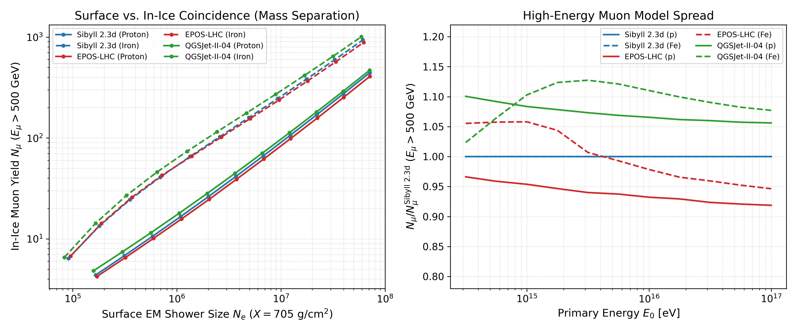
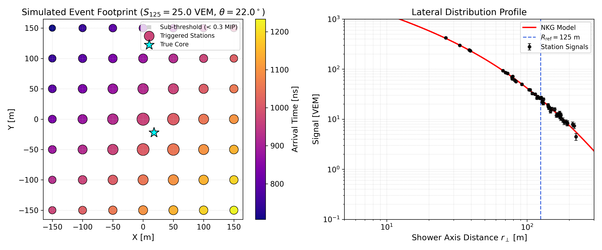
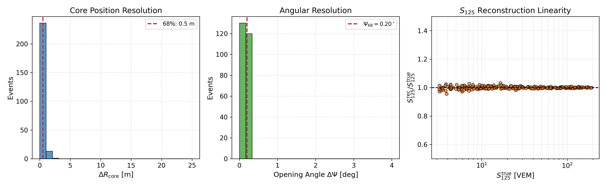

# Surface Hybrid Array Simulation & Air-Shower Reconstruction for IceTop/IceCube

This repository provides a standalone simulation and event reconstruction framework for cosmic-ray extensive air showers (EAS) at the South Pole ($h = 2835\ \mathrm{m}$, atmospheric depth $X \approx 705\ \mathrm{g/cm^2}$). The study addresses two core physical and experimental challenges relevant to the IceTop surface enhancement at the IceCube Neutrino Observatory:

1. **Hadronic Interaction Model Uncertainties:** Solving one-dimensional matrix cascade equations (`MCEq`) in the South Pole atmosphere to quantify high-energy in-ice muon yields ($E_\mu > 500\ \mathrm{GeV}$) and surface electromagnetic shower sizes ($N_e$) across post-LHC hadronic interaction models (`Sibyll 2.3d`, `EPOS-LHC`, and `QGSJet-II-04`).
2. **Maximum-Likelihood Event Reconstruction:** Modeling the spatial and temporal response of a surface scintillation detector array and reconstructing the shower core position $(x_c, y_c)$, arrival direction $(\theta, \phi)$, and lateral distribution scaling parameter $S_{125}$ using `iminuit` (`MINUIT2`).

---

## Repository Structure

```text
├── src/
│   ├── hadronic_mceq.py        # South Pole atmospheric cascade solver (MCEq + MSIS-00)
│   ├── icetop_array.py         # Surface array geometry, NKG LDF, timing front, and radio proxy
│   └── run_reconstruction.py   # Two-step Chi2 / Log-Likelihood reconstruction via iminuit
├── plots/                      # Diagnostic and reconstruction benchmark figures
├── data/                       # Precomputed MCEq lookup tables (mceq_southpole.npz)
└── requirements.txt            # Python package dependencies
```

---

## Physics & Methodology

### 1. Surface vs. In-Ice Coincidence and Hadronic Models
Air showers initiated by primary protons ($A=1$) and iron nuclei ($A=56$) are simulated across the primary energy range $3 \times 10^{14}\ \mathrm{eV} \le E_0 \le 10^{17}\ \mathrm{eV}$ using `MCEq` coupled with the December South Pole MSIS-00 atmospheric density profile (`MSIS00_IC`). High-energy muons ($E_\mu > 500\ \mathrm{GeV}$) capable of propagating to the deep IceCube optical array are integrated alongside the surface electromagnetic cascade size $N_e$ at $X = 705\ \mathrm{g/cm^2}$.



* **Left Panel:** Demonstrates primary mass separation in the $(N_e, N_\mu)$ coincidence space, where heavier nuclei yield a systematically higher high-energy muon bundle multiplicity for a given surface electromagnetic size.
* **Right Panel:** Highlights the $\sim 10\% - 15\%$ systematic spread in TeV muon predictions among `Sibyll 2.3d`, `EPOS-LHC`, and `QGSJet-II-04`.

---

### 2. Surface Array Response & Lateral Distribution Function (LDF)
Surface scintillation detector stations are arranged on a regular grid with $50\ \mathrm{m}$ spacing. Local particle densities are modeled using a Nishimura-Kamata-Greisen (NKG) lateral distribution function normalized to the standard IceTop reference distance $R_{\mathrm{ref}} = 125\ \mathrm{m}$ ($S_{125}$):

$$S(r_\perp) = S_{125} \, \left(\frac{r_\perp}{R_{\mathrm{M}}}\right)^{s - 2} \left(1 + \frac{r_\perp}{R_{\mathrm{M}}}\right)^{s - 4.5} \left[ \text{norm.} \right]^{-1}$$

Detector signals incorporate Poisson photoelectron statistics, Gaussian electronic baseline noise, and a trigger threshold of $0.3\ \mathrm{MIP}$. Station arrival times follow a planar propagation front modified by a parabolic shower-front curvature delay and signal-dependent timing jitter. A geomagnetic radio amplitude proxy ($\propto \vert{}\mathbf{v} \times \mathbf{B}\vert{}$ for the South Pole magnetic field inclination $I \approx -72^\circ$) is also included in the array module.



---

### 3. Maximum-Likelihood Event Reconstruction (`iminuit`)
For triggered events ($\ge 5$ stations above threshold), reconstruction is performed in two stages initialized from a signal-weighted center-of-gravity (CoG) seed:

1. **Shower Axis Direction $(\theta, \phi)$:** Minimizes a timing $\chi^2$ functional over triggered station arrival times accounting for shower-front curvature.
2. **Shower Core $(x_c, y_c)$ & Energy Proxy $S_{125}$:** Minimizes a combined negative log-likelihood ($\mathrm{NLL}$) incorporating both the charge variance of triggered stations and the Poisson zero-hit probability of silent (sub-threshold) stations.



#### Benchmark Results (250 Monte Carlo Showers, $5^\circ \le \theta \le 35^\circ$):
* **Core Position Resolution (68% containment):** $\Delta R_{68} = 0.52\ \mathrm{m}$
* **Angular Resolution / PSF (68% containment):** $\Psi_{68} = 0.20^\circ$
* **$S_{125}$ Reconstruction Linearity:** Unbiased recovery across two orders of magnitude in shower size.

---

## Installation & Usage

Clone the repository and install the required scientific Python packages:

```bash
git clone [https://github.com/parsa-arabzadeh/icetop-hybrid-reco.git](https://github.com/parsa-arabzadeh/icetop-hybrid-reco.git)
cd icetop-hybrid-reco
pip install -r requirements.txt
```

Run the simulation and reconstruction modules sequentially:

```bash
# 1. Solve atmospheric cascade equations and compare hadronic models
python3 src/hadronic_mceq.py

# 2. Generate single-event surface array footprint and LDF profile
python3 src/icetop_array.py

# 3. Run Monte Carlo reconstruction benchmark with iminuit
python3 src/run_reconstruction.py
```

---

## Author
**Parsa Arabzadeh**  
M.Sc. in Physics (Astrophysics & Cosmic-Ray Physics)
